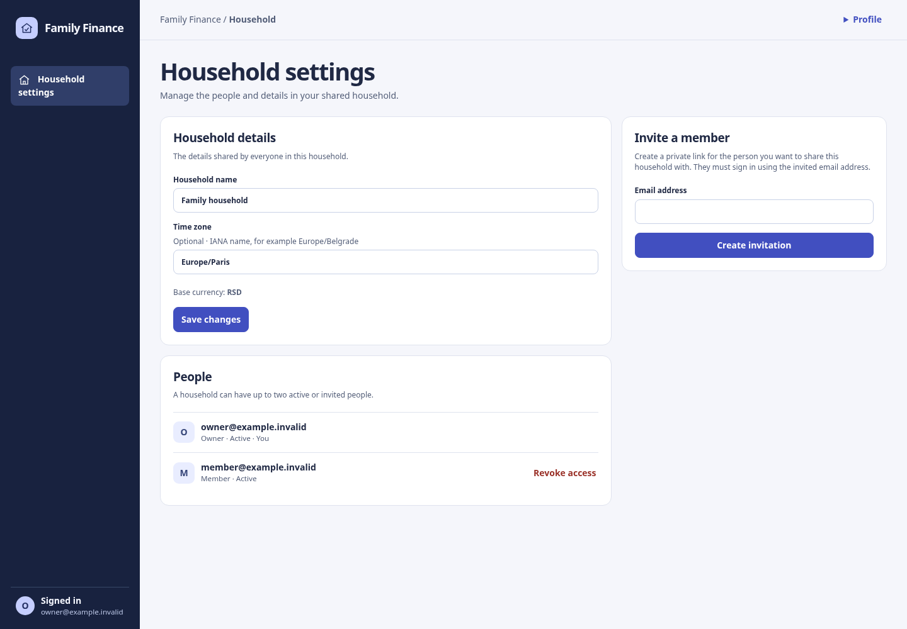
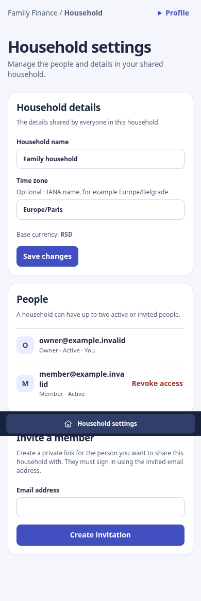
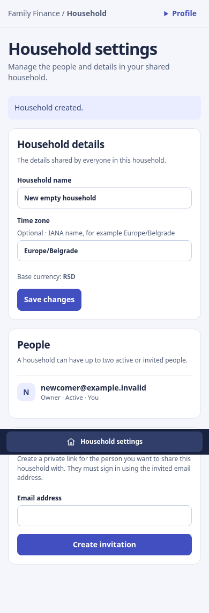

# Issue #5: sign-in and household access

Source: [issue #5](https://github.com/seregka23/finance-repo/issues/5), technical
specification v0.5 sections 1–3, 5–6 and 13–15. Verified locally November 16,
2026 using Node.js 24.22.1, Wrangler 4.163.0 and the installed NestJS 12/Angular 22
applications. This is a local implementation acceptance record, not a production
authentication or deployment claim.

## Delivered behavior

- Cloudflare Access application JWT verification and session/household APIs.
- Empty household creation, saved settings, active owner/member roles, private
  email-bound invitation links, acceptance, cancellation and revocation.
- Live D1 access assertions inside mutation batches and member reads; atomic
  capacity and acceptance constraints in additive migration `0003`.
- Responsive Angular household settings, sign-in/setup states, invitation review,
  owner management and member read access using the saved visual reference.

See the [configuration and API contract](../authentication.md) and
[database authorization contract](../database/access.md). Existing migrations
`0001` and `0002` are unchanged. New households seed no financial records.

## Executed checks

| Command/check | Observed result |
| --- | --- |
| `npm run build` | NestJS, generated Worker types and Angular production builds passed |
| `npm test --prefix backend` | 6 tests passed, including 5 auth cases/groups |
| `npm run test:e2e --prefix backend` | 11 existing HTTP tests passed |
| `npm run lint --prefix backend` | Passed |
| `npm test --prefix frontend -- --watch=false` | 5 tests passed, including invitation form submission and fragment handling in an open app |
| `npm run verify:schema` | 13 schema groups passed with all three migrations; baseline rows and migration history preserved |
| `npm run verify:access -- --serve` | All 7 access groups passed in actual Wrangler/Workerd and disposable local D1; fixture then retained for browser checks |
| `node scripts/verify-local-d1.mjs` | Existing real Worker/D1 probe, routing, persistence, migration replay and cleanup passed with current migrations |
| `npx wrangler deploy --env '' --dry-run` | Worker and static assets packaged successfully; no deployment |
| `node --check scripts/verify-access.mjs`, `git diff --check` | Passed |

The repeatable convenience command `npm run verify:access` performs the build
and the same access verification without retaining the browser fixture. The
managed workspace used `XDG_CONFIG_HOME=/tmp/finance-cloudflare-config` and
`WRANGLER_SEND_METRICS=false` for CLI logs/configuration. The access verifier
isolates its own CLI configuration and database in a temporary directory.

## Acceptance evidence

| Scenario | Observed result |
| --- | --- |
| Signed identities | Real RSA-signed fixture JWTs worked through assertion headers and cookies; missing, forged, wrong-issuer/audience/key, expired and future-dated tokens were rejected |
| Key retrieval | Unit tests verified public-key caching, unknown-key refresh throttling, malformed JWKS rejection and fetch timeout; no identity/membership cache is used |
| Request rejection | Foreign or missing mutation Origin was rejected; malformed JSON returned sanitized `INVALID_INPUT`; API responses used `no-store` |
| Empty household | Creation persisted one household and its owner. Accounts, categories, transactions, plans, reserves and import drafts remained empty |
| Second signed-in session | Accepted invited email saw the same saved household ID, name and time zone. The browser also confirmed the shared saved name |
| Isolation | An unrelated signed identity could not read or update a supplied household ID or use another household's resource IDs |
| Owner controls | Members could not edit household settings, invite or revoke. Owners could not revoke themselves |
| Invitation safety | Wrong-email, replayed, canceled and expired tokens were rejected. Tokens were absent from listings; only a hash was stored |
| Concurrent capacity/acceptance | Two competing invitations produced one 201 and one 409; two confirmations of one token produced one 201 and one 409, leaving two active members |
| Atomic authorization | The production access-batch helper allowed both active members to share saved fixture writes. Cross-household and revoked identities failed before writes persisted |
| Revocation | A previously valid signed token immediately lost subsequent household read/write access after revocation; session listing omitted the household |
| Integrity | `PRAGMA foreign_key_check` returned no violations; earlier schema replay and numeric/scoping checks remained green |

The batch proof uses an additional table and route defined **only in the
temporary verification entrypoint**. It verifies the authorization boundary for
future financial write batches; it is not a financial posting API. Financial
features must use that helper and add their own financial/version assertions.

## Browser and visual evidence

A headless Chromium/Playwright check exercised actual Angular, the Worker API
and local D1 using synthetic signed fixture sessions. It created and saved
settings, created/canceled an invitation, accepted its fragment link in a second
browser context, confirmed the shared name and member permissions, revoked
access with confirmation, and created another empty household. It also opened the Profile menu and
confirmed its settings and sign-out links.

Desktop (1440px) and mobile (390px) checks found no horizontal overflow or page
errors. axe checks with WCAG 2/2.1/2.2 A/AA tags reported **zero violations** on
the desktop, mobile and new-household states. This automated result does not
claim exhaustive accessibility certification or every future screen.

The screenshots below contain synthetic test identities, not real household
data. The mobile captures are full-page images: the fixed navigation appears
at the captured viewport's bottom while additional scrollable content follows.

## Independent review and remaining setup

Database and backend specialists coordinated the migration and assertion
contract; the frontend specialist implemented the settings surface. Independent
security review identified repeated signing-key retrieval; bounded caching,
refresh cooldown and timeout resolved that finding. The reviewer confirmed the
fix. Independent finish review inspected all three captures and source and
returned **ship**, with no material finish defects. Impeccable's launcher and
detector were unavailable; existing project design context was read directly.

No real Access application, provider policy or session was configured or tested.
Set the actual Access team domain, audience and public origin and protect the
whole application hostname before real sign-in. Then rehearse two real provider
sessions on the intended test deployment. D1 invitation creation does not modify
the provider's separate allow policy.

No remote migration or deployment was executed. Production D1 identity, public
hostname, Access policy and production recovery rehearsal remain release tasks.
Financial posting, reports, exports and recognition/import workflows remain
their later issues; their handlers must retain the access boundary documented
here. Account ownership is display/filtering and does not add account secrecy.
