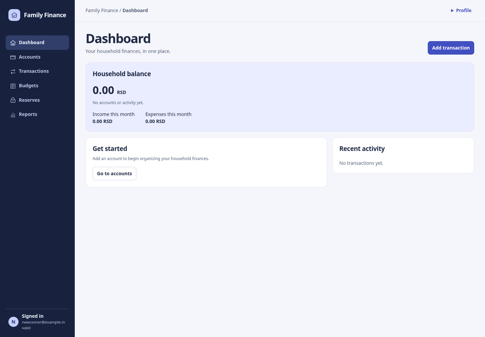
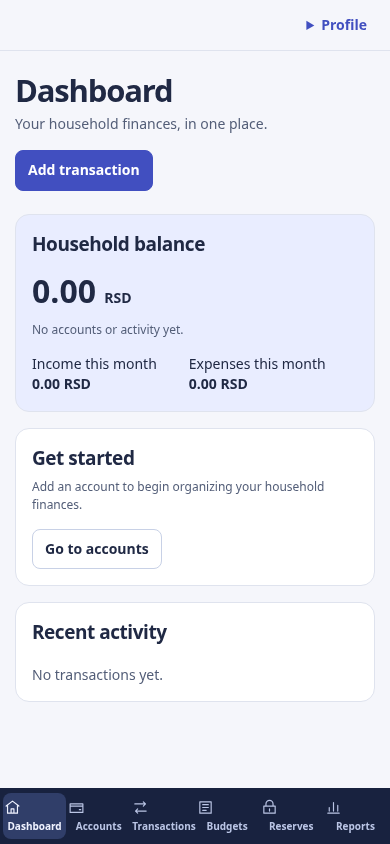
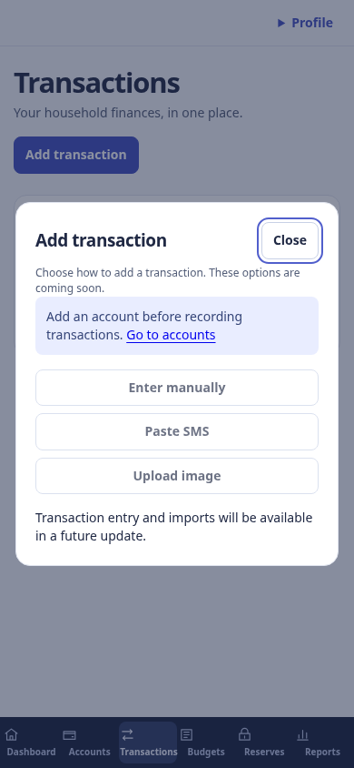
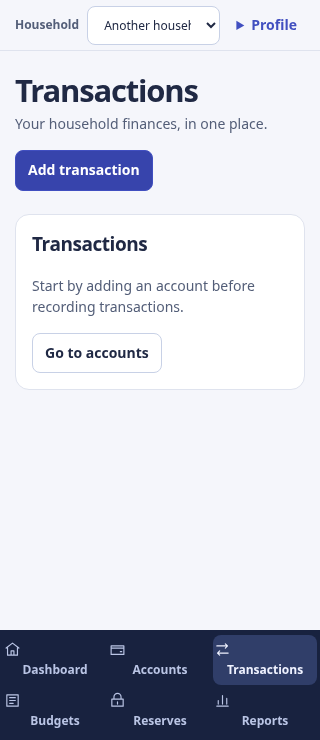

# Issue #6: navigation and first-use states

Source: [issue #6](https://github.com/seregka23/finance-repo/issues/6) and
technical specification v0.5 sections 3, 6 and 15. Verified locally on November
16, 2026 using Node.js 24.22.1, Wrangler 4.163.0, Angular 22, NestJS 12 and
headless Chromium. This record covers navigation/state foundations; detailed
financial features remain their later issues.

## Delivered behavior

The six lazy routes follow Dashboard → Accounts → Transactions → Budgets →
Reserves → Reports, with Profile → Household settings. Browser titles, current
links, focused headings, refresh and history work across the routes. Household
selection applies to all pages. A signed-in person without a household has a
working path to create one.

First-use pages use real, authorized household counts. Loading and errors do not
masquerade as empty results; retry reads again and stale responses cannot replace
a newly selected household. Fresh households show zero amounts with currency;
nonempty households show saved counts while detailed calculations are unavailable.
The transaction chooser handles Close, Escape, Tab/Shift+Tab wrapping, repeated
opening, focus restoration and household changes.

Detailed account management, manual/SMS/image posting, budgets, reserves and
reports are not implemented by this issue. Their actions remain disabled with
visible reasons. The reusable no-match/reset pattern is tested, but no live
filters are exposed before a real list API exists. See the
[surface brief and workspace API contract](../ui/navigation.md).

## Executed checks

| Command/check | Result |
| --- | --- |
| `npm run build` | Backend, generated Worker types and Angular production builds passed; Angular was rebuilt after final UI corrections |
| `npm test --prefix backend` | 9 tests passed |
| `npm run test:e2e --prefix backend` | 11 HTTP regression tests passed |
| `npm run lint --prefix backend` | Passed |
| `npm test --prefix frontend -- --watch=false` | 10 tests passed, covering existing sessions/forms plus stale workspace responses, retry, no-match reset, routes and chooser behavior |
| `node scripts/verify-navigation.mjs` after build | 8 browser groups passed; the child actual Worker/local-D1 verifier also passed all 8 access/workspace groups |
| `npx wrangler deploy --env '' --dry-run` | Worker and assets packaged; no deployment |
| Script syntax and `git diff --check` | Passed |

`npm run verify:navigation` is the convenience command for the build plus the
same verifier. Chromium must be installed; see the root README for discovery and
installation options. Playwright Core and the axe adapter are pinned development
dependencies and do not download a browser during ordinary dependency install.

The managed workspace used an isolated CLI config/log directory and disabled
Wrangler metrics. Verification starts a private signed-JWT fixture and temporary
D1 store, then cleans up its processes and database. Artifact screenshots and the
[report](issue-6/report.json) remain available. Normal local state and remote
databases were not touched.

## Acceptance evidence

| Scenario | Observed result |
| --- | --- |
| Empty household | Browser followed the creation link, saved a household and saw real zero counts and zero RSD first-use totals |
| Desktop and mobile navigation | All six routes worked at 1440px and 390px with correct titles/current links, no horizontal overflow and focused headings after route changes |
| Current destination | Only the current route has the persistent selected background; Settings has no selected financial destination |
| Delivered actions | Profile opens settings; account prompts navigate; future actions are disabled; chooser opens from transaction entry points |
| Dialog keyboard | Enter opens; repeated opening is prevented; Tab and Shift+Tab stay within enabled controls; Close/Escape restore focus |
| Refresh/history | Reports survived refresh; browser Back and Forward restored Accounts/Reports |
| Loading | A deliberately held real request showed loading and no false empty results |
| Failure/retry | A controlled 503 showed an error rather than empty content; retry returned to the real successful response |
| Narrow layout | At 320px, household selection remained usable without overflow; the two-row bottom navigation retained all six destinations |
| Household switching | Changing the selected household closed its open dialog and loaded the new scope; unit coverage rejected an older in-flight response |
| API counts and access | Actual local D1 fixtures produced positive counts in all five fields. Another household remained empty, an unrelated identity was rejected and revocation blocked the next workspace read |
| Accessibility | axe found zero WCAG 2/2.1/2.2 A/AA violations across 12 route/viewport states, two dialog states, Settings and the 320px switching case; no browser page errors were recorded |

Native API checks additionally retained the earlier sign-in, invitation,
concurrent acceptance, batch authorization and revocation coverage. Positive
financial-count fixtures were explicitly inserted and removed inside the owned
test store; household creation itself seeds no financial records. The count
endpoint uses a membership assertion and a scoped query in one D1 batch.

## Visual evidence and review

These captures show synthetic signed local test identities and an empty test
household, not real user financial data. The independent finish reviewer
inspected all six views and the source. The review identified indistinguishable
active navigation; after the single correction batch and recapture, the reviewer
marked that finding **resolved** and approved shipping from the review's scope.

Additional captures: [Reports](issue-6/mobile-reports.png) and
[Household settings](issue-6/desktop-settings.png).

The frontend specialist owned the interface; the backend specialist supplied the
read contract. The lead integrated real runtime/browser verification and fixes.
The existing design/template and migrations are unchanged. Impeccable's context
launcher/detector remained unavailable; project context was read directly and
the finish review used the actual captures and source.

## Remaining boundaries

No remote deployment, migration, resource creation or identity-provider
configuration was performed. Real Cloudflare Access setup and target-environment
rehearsal remain as documented in issue #5. Future financial feature issues must
provide their actual API, action handlers and detailed validation before enabling
these controls. Automated axe and targeted keyboard checks do not claim complete
accessibility certification or validation of future screens.
