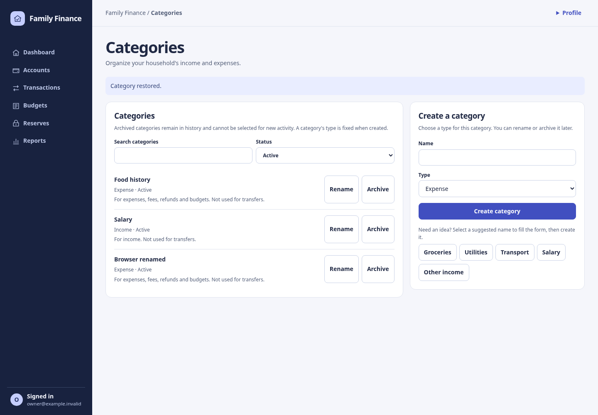
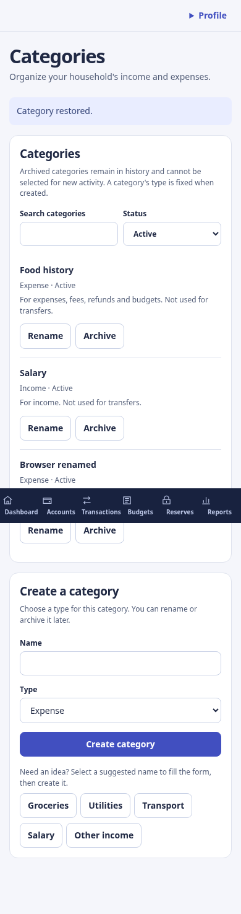
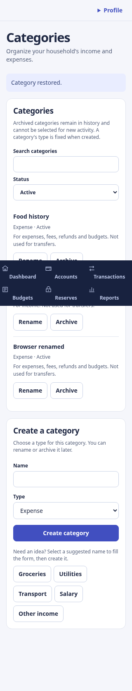

# Issue #7: household categories and eligibility

Source: [issue #7](https://github.com/seregka23/finance-repo/issues/7), technical
specification v0.5 sections 3–5 and 8.5. Verified locally on November 17, 2026
with Node.js 24.22.1, npm 11.9.0, Wrangler 4.163.0 and the installed NestJS 12 /
Angular 22 applications.

## Delivered behavior

Both household members can create expense/income categories, rename them,
archive them and restore them through Profile → Categories or household settings.
Real search/status filters and reset work on saved categories. Optional reference
names fill a draft only; creation requires explicit submission.

The active-only options API exposes transaction/budget eligibility, and a SQL
assertion supports atomic validation by future posting/decision consumers.
Historical references keep their category IDs; renamed categories display their
current name, archived categories remain readable, and type is immutable. No
hard-delete API is provided. See the [API/UI contract](../ui/categories.md) and
[database contract](../database/categories.md).

Migration `0004` adds only an assertion view and triggers; earlier migrations and
the saved design reference are unchanged. No financial records are seeded.

## Executed validation

| Command/check | Observed result |
| --- | --- |
| `npm run build` | Backend, generated Worker types and Angular production builds passed; Angular was rebuilt after final UI fixes |
| `npm test --prefix backend` | 14 tests passed |
| `npm run test:e2e --prefix backend` | 11 HTTP regression tests passed |
| `npm run lint --prefix backend` | Passed |
| `npm test --prefix frontend -- --watch=false` | Frontend specialist ran and reported 13 passing tests after the form/label/focus changes |
| `npm run verify:schema` | All 13 groups passed with migrations `0001`–`0004`; legacy probe, replay/history and scoped constraints preserved |
| `node scripts/verify-categories.mjs` after build | All 8 category groups passed: 6 native API/D1 groups plus 2 browser-flow groups; its child also passed all 8 baseline access/workspace groups |
| `npx wrangler deploy --env '' --dry-run` | Worker and assets packaged successfully; no deployment |
| Script syntax / whitespace checks | Passed |

`npm run verify:categories` is the convenience command for build plus the same
verifier. Chromium setup matches `verify:navigation`; no new browser dependency
was required. The managed workspace used isolated CLI config/log locations and
disabled Wrangler metrics. The verifier owns its temporary Worker entrypoint,
signed identities and D1 store and cleans them up. Normal local/remote databases
are not used.

## Acceptance evidence

| Scenario | Observed result |
| --- | --- |
| No automatic seeding | A fresh household listed no categories; fetching reference names did not change the list or transaction count |
| Both roles | Owner and accepted member created/read/updated categories in the same household |
| Eligibility | Expense, fee, refund and budget options returned only active expense categories; income returned active income categories; transfer returned no category |
| Invalid requests | Empty/overlong names, invalid types/status, unknown fields, missing/unknown usage and public type changes returned 400 |
| Isolation | Foreign category IDs were not readable/updatable through an accessible household; unrelated identities could not list/create categories or read reference names |
| Revocation | After owner revocation, the previously signed member could no longer list, create, update, read detail, fetch options or read reference names |
| Atomic stale-selection rejection | SQL assertions rejected archived, missing, wrong-type and foreign categories, invalid usage and non-null transfer category; an earlier fixture write in each failed batch was rolled back |
| Historical references | An actual local D1 transaction and monthly plan kept the same category ID after rename/archive; historical reads remained available with the current name |
| Immutable type | Direct guarded SQL attempts to retype both a referenced expense category and an unreferenced income category failed; stored types stayed unchanged |
| Restore | Reactivating the archived category made it eligible again without changing its ID |
| Concurrent fields | Parallel rename and archive updates retained both changes atomically |
| Browser CRUD | Actual Angular/Worker/D1 flow created, renamed, archived and restored a category; refresh retained saved data |
| Optional names | Clicking Groceries filled the form but did not change the persisted count before submitting |
| Filters and keyboard | Real status/search filters, no-match reset and Enter-based create/save/reset worked |
| Loading / error / retry | A held list request showed loading rather than an empty result; a controlled API 503 showed an error, and retry recovered using the real successful response |
| Responsive/accessibility | No page errors or horizontal overflow at 1440, 390 and 320px; axe reported zero WCAG 2/2.1/2.2 A/AA violations in all three captured states; filter bounding boxes did not intersect |

The fixture's history and assertion routes exist only in the generated test
entrypoint. They exercise production category/access services and actual D1
behavior, including `UPDATE ... RETURNING` and rollback. They are not production
financial posting APIs, and their synthetic history rows are not application
seeds. Future transaction/budget writes must actually include the category
assertion in their authorized batch.

## Review and visual evidence

Database, backend and frontend specialists owned bounded parts; the lead
integrated the runtime proof and corrections. Independent integrity review found
no actionable category scoping, history or migration issue, with financial
posting integration explicitly outside that review. Independent UI review found
overlapping mobile Search/Status controls; the targeted CSS fix and all three
recaptures were reviewed and that finding was confirmed **resolved**.

The following captures contain synthetic test identities and category names.
Full-page mobile captures show the fixed navigation at the viewport bottom while
additional scrollable content follows; bottom clearance remains available.

The [machine-readable report](issue-7/report.json) records the eight verification
groups. The context launcher/detector remained unavailable; existing design
context was read directly. Automated axe and targeted keyboard checks are not
an exhaustive accessibility certification.

## Release and handoff boundaries

No remote migration, deployment or provider configuration was performed. Apply
reviewed migration `0004` to the explicit intended target separately using the
[migration/recovery guide](../database/migrations.md). It does not rewrite or
retroactively validate existing financial data. Prefer a forward correction if
needed; removing enforcement objects removes their protections.

Real Access setup remains unchanged from issue #5. Detailed financial posting,
budgets and decision-provider integrations remain later features. Management
lists include archived categories intentionally; new selectors must use eligible
options and recheck eligibility in the dependent write batch. Category changes
to the same field use the last successful write; no version/conflict protocol is
introduced for categories.
